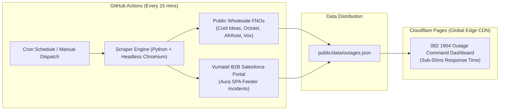

# Vodacom FTTH (082 1904) NOC — Live Outage Command Center

Autonomous, high-performance wholesale FNO and Vumatel B2B ISP incident intelligence platform built for **Vodacom FTTH (082 1904) NOC & Fault Management teams** at Merchants CX.

---

## ⚡ Architecture Overview



1. **Autonomous Cloud Engine**: Runs every **15 minutes** via GitHub Actions with zero local machine dependencies.
2. **Vumatel B2B ISP Radar**: Headlessly navigates Vumatel's Salesforce Community Aura portal, aggregating customer breaks into verified Master Feeder Incidents with impacted lines and aggregation zones.
3. **Wholesale FNO Multi-Feed**: Continuously aggregates public NOC notices from Cool Ideas, Octotel, Afrihost, Vox, Openserve, MetroFibre, Frogfoot, and more.
4. **Cloudflare Pages Edge Delivery**: Serves the operational dashboard globally with sub-50ms latency, zero cold-starts, and client-side multi-token filtering.

---

## 🚀 Cloudflare Pages Setup (1-Minute Deploy)

1. Log into your [Cloudflare Dashboard](https://dash.cloudflare.com/).
2. Navigate to **Workers & Pages** → **Create application** → **Pages** → **Connect to Git**.
3. Select this repository: `vodacom-ftth-outages`.
4. Configure Build Settings:
   - **Framework preset**: `None`
   - **Build command**: *(leave blank)*
   - **Build output directory**: `public`
5. Click **Save and Deploy**.

Your live dashboard will instantly be active at `https://<project-name>.pages.dev`!

---

## 🔐 GitHub Secrets Configuration (Optional)

If you wish to customize or rotate credentials, add these repository secrets under **Settings** → **Secrets and variables** → **Actions**:

- `VUMA_USERNAME`: Your Vuma B2B login email (e.g. `Jody.Stainbank@Merchantscx.com`)
- `VUMA_PASSWORD`: Your Vuma B2B portal password

---

## 🖥️ Local Development & Testing

```bash
# 1. Install dependencies
pip install -r requirements.txt
playwright install chromium

# 2. Run local sync
python scripts/sync_all_outages.py

# 3. Serve the dashboard locally
cd public
python -m http.server 8080
```
Open [http://localhost:8080](http://localhost:8080) to test the live dashboard locally.
